# CI/CD Pipeline — Fully Explained (Jenkins → GitHub Actions)

This document explains, in plain words **and with diagrams**, what our CI/CD
pipeline does, why each part exists, and how the GitHub Actions version in
this repo (`surelm-form`) works. It replaces the old manual-upload / Jenkins
way of getting code onto the server **without changing the safety behavior**.

**Reading tip:** every chart below is written in "mermaid" syntax. On GitHub
they render automatically. In VS Code, install the *Markdown Preview Mermaid*
extension and press `Ctrl+Shift+V` to see them.

---

## Table of contents

1. [What is this project? (big picture)](#1-what-is-this-project-big-picture)
2. [Glossary — words you will see often](#2-glossary--words-you-will-see-often)
3. [The big picture diagram](#3-the-big-picture-diagram)
4. [The 4 stages in detail](#4-the-4-stages-in-detail)
5. [Main pipeline flow (full chart)](#5-main-pipeline-flow-full-chart)
6. [Project-type detection](#6-project-type-detection)
7. [Deploy protection layers (defense in depth)](#7-deploy-protection-layers-defense-in-depth)
8. [Backup & rotation explained with diagrams](#8-backup--rotation-explained-with-diagrams)
9. [rsync + exclude list explained with diagrams](#9-rsync--exclude-list-explained-with-diagrams)
10. [Health check & rollback explained with diagrams](#10-health-check--rollback-explained-with-diagrams)
11. [Safety rules (Layer 5) explained with diagrams](#11-safety-rules-layer-5-explained-with-diagrams)
12. [Secrets and Variables](#12-secrets-and-variables)
13. [Jenkins → GitHub Actions cheat sheet](#13-jenkins--github-actions-cheat-sheet)
14. [How to verify a run](#14-how-to-verify-a-run)

---

## 1. What is this project? (big picture)

We are replacing **manual uploads (and the old Jenkins practice pipeline)**
with **GitHub Actions**.

- **Jenkins** is software that needs its own server running 24/7 — money and
  maintenance. Manual uploads are slow and error-prone (wrong folder, missed
  files, no backup).
- **GitHub Actions** runs on **GitHub's own computers** ("runners"),
  automatically, whenever code is pushed. No server to maintain.

**This repo (`surelm-form`)** is the SureLM application form site:

| Piece | Role |
|---|---|
| `index.html` | the application form page |
| `quokka.php` | the form handler — validates fields/uploads and sends the application via PHP `mail()` |
| `thank-you.html` | shown after a successful JSON `{success: true}` response |
| `.htaccess` | Apache rewrite rules for referral slugs (`/soham/`, `/saksham/`, `/harsh/`, `/harshit/`) + security headers + caching |
| `css/`, `js/`, fonts, icons | static assets |

There is **no build step** (no `package.json`, no `composer.json`) — the repo
root *is* the deployable site. The pipeline still runs, because its real job
is the **deploy half**: backup → upload → verify → rollback.

**Goal:** when code is pushed to `main`, GitHub automatically:

1. downloads the code (**Checkout**),
2. lints the PHP (**`php -l quokka.php`** — catches syntax errors before they
   can reach the server),
3. copies the site to our HostGator cPanel server over SSH (**Deploy**),
4. verifies it, and **rolls back automatically** if anything is wrong.

### CI vs CD — the two halves

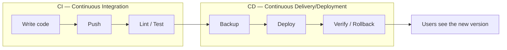

- **CI** = *did the code pass checks?* Runs on **every** push and PR.
- **CD** = *put the verified code on the server.* Runs **only** on `main`.

---

## 2. Glossary — words you will see often

| Word | Plain meaning |
|------|---------------|
| **Workflow** | A YAML file in `.github/workflows/` that tells GitHub what to do and when. |
| **Job** | One unit of work inside a workflow (`build-test`, `deploy`). Jobs run on separate runners; `deploy` depends on `build-test` via `needs:`. |
| **Step** | One command inside a job. Steps run one after another in the same job. |
| **Runner** | The temporary computer GitHub gives us for a run. Destroyed afterwards. `ubuntu-latest` = a Linux VM. |
| **SSH** | Secure Shell — encrypted remote login, like sitting at the server's keyboard. Uses a **key pair**: private key stays secret (our "password"), public key sits on the server (the "lock"). |
| **rsync** | A copy tool that only transfers changed files and can delete files on the destination that no longer exist locally (`--delete`). |
| **cPanel** | The hosting control panel (HostGator gives us one at `sh020.hostgator.in:2083`). `public_html/` is the web-visible folder. |
| **Environment** | A GitHub feature: a named deployment target (`demo`, `production`) that can require a human to click *Approve* before a deploy continues. |
| **Concurrency group** | A "one lane" queue: only one run per group at a time. The other runs wait. |
| **Rollback** | Restoring the previous version from a backup after a bad deploy. |
| **Staging folder** | A private, web-accessible test folder (`public_html/staging-surelm/`). First deploys land here — the real site is never the test subject. |

---

## 3. The big picture diagram

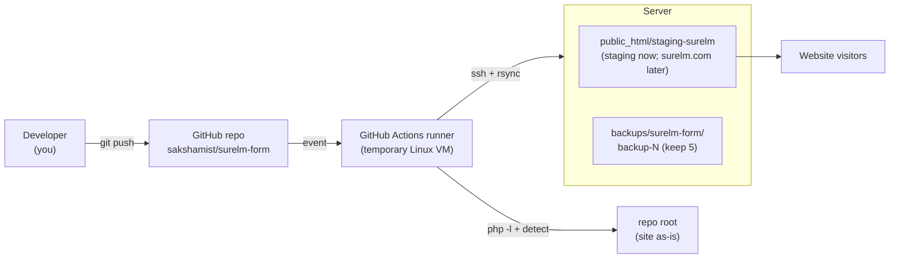

**What happens, step by step:**

1. You run `git push` to `main`. GitHub receives the new commit.
2. GitHub sees the rule in `deploy.yml`: "on push to `main`, run the
   pipeline". It starts a **run**.
3. A **runner** boots — a clean VM that exists only for this run.
4. The runner downloads the code and runs `php -l quokka.php` (and the
   npm steps, which skip themselves because there is no `package.json`).
5. If checks passed **and** this is a push to `main`, the runner opens an
   SSH connection to the HostGator server and copies the site into the
   `REMOTE_DIR` folder with rsync (after taking a backup).
6. The runner checks the entry file is present (and, if `SITE_URL` is set,
   that the page responds). If not → automatic rollback from the backup.
7. The runner is destroyed. Visitors now see the new version.

---

## 4. The 4 stages in detail

### 4.1 Stage map

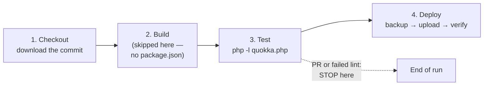

### 4.2 Checkout

| Topic | Detail |
|-------|--------|
| **What** | `actions/checkout` downloads the exact commit that triggered the run onto the runner. |
| **Fails if** | GitHub cannot reach the repo (never, for a push-triggered run). |

### 4.3 Build

| If the repo has… | The pipeline does… |
|---|---|
| `package.json` (Node) | `npm ci` → `npm run build --if-present` |
| **no `package.json` (this repo)** | prints *"No package.json (static/PHP repo) - skipping npm"* and moves on |

The build steps keep `--if-present` flags so they can never hard-fail a repo
that does not use them. **This repo deploys as-is** — no `dist/` is produced;
the upload folder is the repo root.

### 4.4 Test

This repo has no test framework, so the pipeline runs the one check that
matters for `quokka.php`:

```bash
php -l quokka.php     # "No syntax errors detected" or it FAILS the run
```

**Golden rule:** a red check **stops the pipeline before Deploy**. A
`quokka.php` with a syntax error can never reach the server — a broken form
handler would silently lose real applications.

### 4.5 Deploy (only on push to `main`)

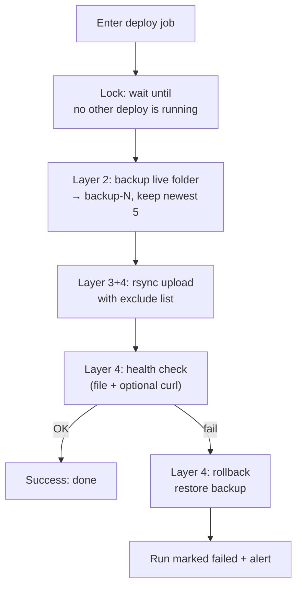

---

## 5. Main pipeline flow (full chart)

```mermaid
flowchart TD
    A["Push or PR to GitHub"] --> B{"Event type?"}
    B -- "Pull request" --> C["BUILD + TEST only<br>🚫 never touches the server"]
    B -- "Push to main" --> C2["BUILD + TEST"]
    C --> D{"Checks passed?"}
    C2 --> D
    D -- "No" --> E["❌ Stop. Mark run failed.<br>Alert step (echo for now)."]
    D -- "Yes" --> F{"index.html exists<br>at repo root?"}
    F -- "Yes" --> G3B["Deploy folder = repo root<br>health file = index.html"]
    F -- "No" --> E
    G3B --> H["Concurrency: wait for a free<br>deploy slot (one at a time per APP_NAME)"]
    H --> I["Layer 2: Backup live folder<br>→ backup-&#60;run&#62;, keep newest 5"]
    I --> J["Layer 3: rsync -az --delete<br>with exclude list + SERVER_ONLY"]
    J --> K{"Layer 4: Health check<br>1) index.html exists on server?<br>2) curl SITE_URL (if set)?"}
    K -- "Yes" --> L["✅ Done — success.<br>version.txt notes run + commit."]
    K -- "No" --> M["Layer 4: Rollback<br>rsync backup → live folder"]
    M --> E
```

**Reading the chart:**

- Left path (PR): feedback only, zero risk.
- Middle path (push to `main`): full pipeline including deploy.
- Any red box: the run ends **failed** — humans look at it. The target folder
  is either untouched or already rolled back.

---

## 6. Project-type detection

One workflow file must serve **many** repos. So the pipeline *detects* what
it is dealing with:

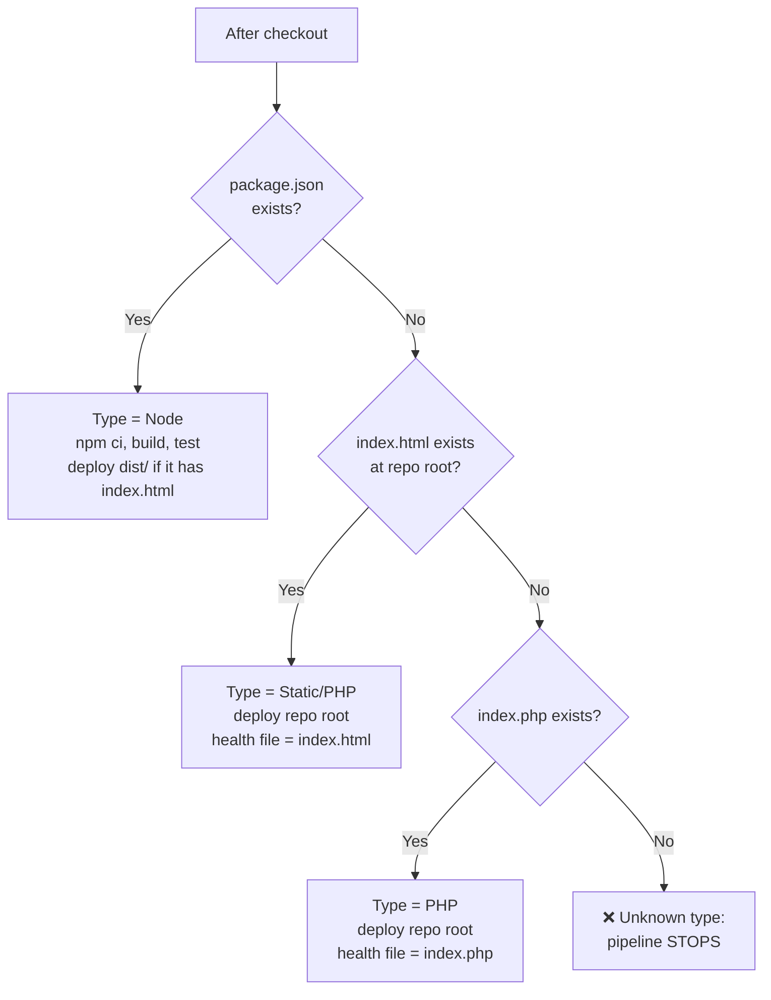

**For `surelm-form`:** no `package.json`, but `index.html` exists at the
root → **upload = repo root, health file = index.html**.

**Guard before deploy:** the pipeline refuses to deploy if the upload folder
contains **neither** `index.html` **nor** `index.php`. This matters because
rsync uses `--delete` — uploading an empty folder would wipe the live site.
Better to fail loudly than to delete a website by accident.

---

## 7. Deploy protection layers (defense in depth)

"Defense in depth" = several independent safety nets, so one failure alone
cannot destroy the site.

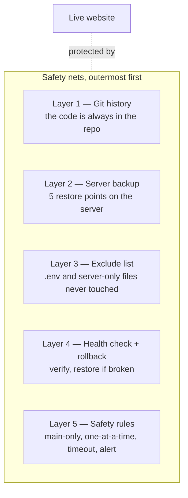

### Layer 1 — Git history (the base recovery path)

The code is always in the repository. Worst case: `git revert` or re-deploy
any old commit. Nothing that ever reached production is "lost" — it is all in
git.

### Layer 2 — Backup before deploy

Before uploading anything, the **target folder is copied on the server** to a
backup folder located **outside** the web path that must not be served
(never inside the live folder):

```
cp -a <REMOTE_DIR>  <BACKUP_DIR>/backup-<run number>
```

- Only the **newest 5** backups are kept; older ones are deleted.
- Think of it as a "save game" before a boss fight — see section 8.

### Layer 3 — Exclude list (never touch server-only files)

The upload uses `rsync --delete` (files missing from the upload get deleted on
the server). To protect files that **only exist on the server**, an exclude
list is used. Excluded files are **never uploaded and never deleted**:

- **Always excluded:** `.git/`, `.github/`, `.gitignore`, `Jenkinsfile`,
  `.rsync-exclude`, `.env`, `.env.*`, `node_modules/`, `tests/`, `tmp/`.
- **Per-repo extras** via the `SERVER_ONLY` variable (one path per line).

### Layer 4 — Health check + automatic rollback

After the upload, two checks run:

1. **Remote file check:** `test -f` for `index.html` inside the target folder.
2. **Site check (optional):** `curl` against `SITE_URL` with a few retries —
   skipped automatically while `SITE_URL` is empty.

If **either** check fails → **rollback**: the latest backup is rsynced back
over the target folder (same exclude list), and the run is marked **failed**
so humans notice.

### Layer 5 — Safety rules

| Rule | Why it exists |
|------|---------------|
| Only pushes to `main` deploy | Feature branches and PRs can never touch the server. |
| PRs only build and test | Fast feedback with zero risk. |
| One deploy at a time per app (`concurrency` group, `cancel-in-progress: false`) | A running deploy is **never cancelled halfway** — half-deployed sites are the classic outage cause. |
| Job `timeout-minutes` | A hung job cannot block the queue forever. |
| Failure alert step (`echo` for now) | Placeholder until the team decides where alerts go (Slack/email). |

---

## 8. Backup & rotation explained with diagrams

### What happens on the server

```mermaid
flowchart TD
    subgraph Before["Before deploy"]
        Live1["staging-surelm/<br>OLD version"]
    end
    Live1 -->|cp -a (copy)| NewB["backups/surelm-form/backup-8<br>exact copy of OLD"]
```

### Rotation — keep only the newest 5

Each deploy creates `backup-<run number>`. After copying, the pipeline lists
backup folders **newest first** and deletes everything from the 6th onwards:

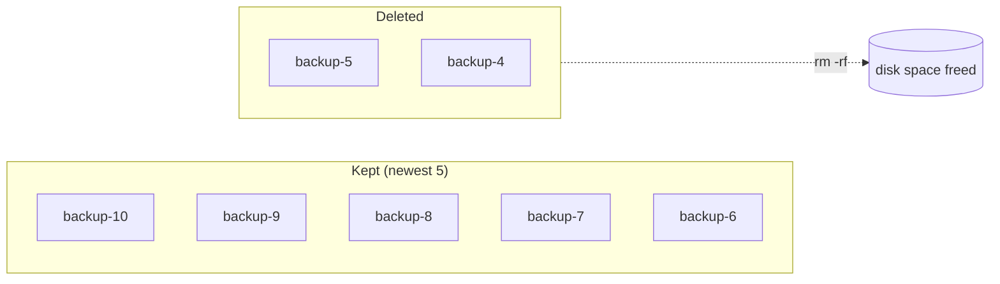

The actual command (same as the original Jenkinsfile):

```bash
ls -1dt $BACKUP_DIR/backup-* | tail -n +6 | xargs -r rm -rf
# list backups newest-first → skip the first 5 → delete the rest
```

**Why outside the live folder?** A backup inside the web root could be
downloaded by anyone who guesses the URL, and `rsync --delete` could one day
sweep it. cPanel accounts have private folders under `/home1/<user>/` that
the web server never serves — that is where backups go.

---

## 9. rsync + exclude list explained with diagrams

### The upload command

```bash
rsync -az --delete --exclude-from=.rsync-exclude \
      -e "ssh ..."  ./  user@host:$REMOTE_DIR/
```

| Flag | Meaning |
|------|---------|
| `-a` | archive mode: copy recursively, keep permissions, timestamps |
| `-z` | compress during transfer (faster on slow links) |
| `--delete` | remove files on the **server** that no longer exist locally (so renamed/removed assets disappear) |
| `--exclude-from` | read the exclude list from a file |
| `-e "ssh ..."` | send the data over SSH (encrypted) |
| `./` (trailing slash) | copy the **contents** of the folder, not the folder itself |

### How `--delete` + excludes work together

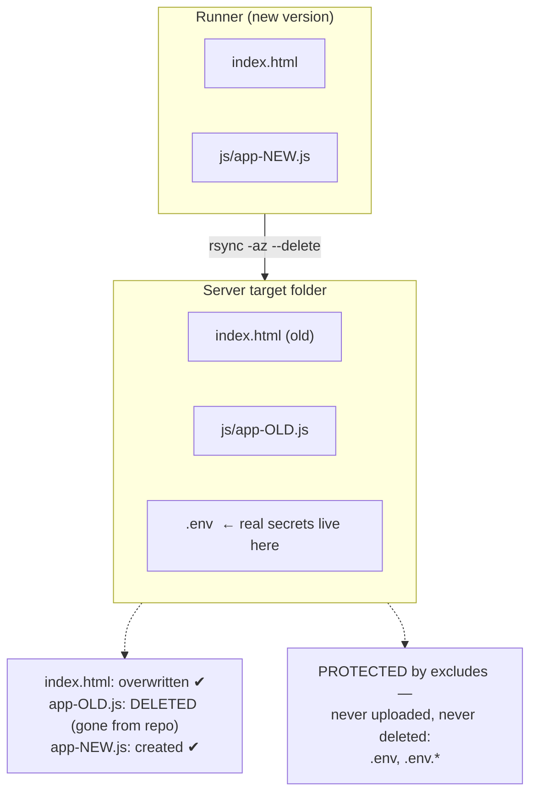

Mental model: **excluded = invisible to rsync**. It is as if those files do
not exist on either side — so they can neither be overwritten nor deleted.

> **Note on `.htaccess`:** it is **not** excluded — the referral-slug rewrites
> and security headers must reach the server with every deploy.

---

## 10. Health check & rollback explained with diagrams

### Happy path

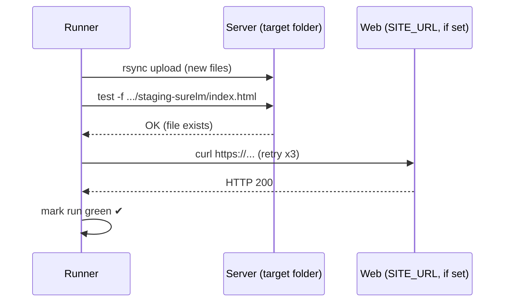

### Sad path → automatic rollback

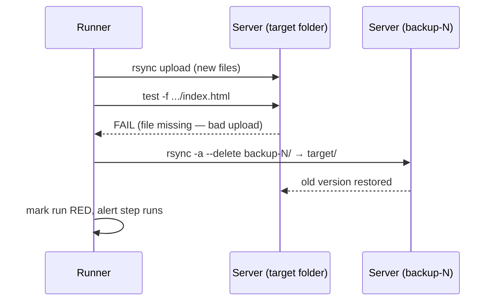

**Key points:**

- The rollback uses the **same exclude list**, so restoring the backup also
  cannot clobber server-only files.
- The run is **still marked failed** — rollback fixes the site, not the bug.
  Someone must investigate.
- Rollback happens **inside the concurrency lock**, so no other deploy can
  race with it.

---

## 11. Safety rules (Layer 5) explained with diagrams

### Only `main` deploys; PRs only build/test

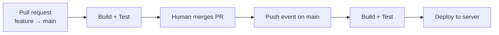

### One deploy at a time (concurrency, never cancel a running deploy)

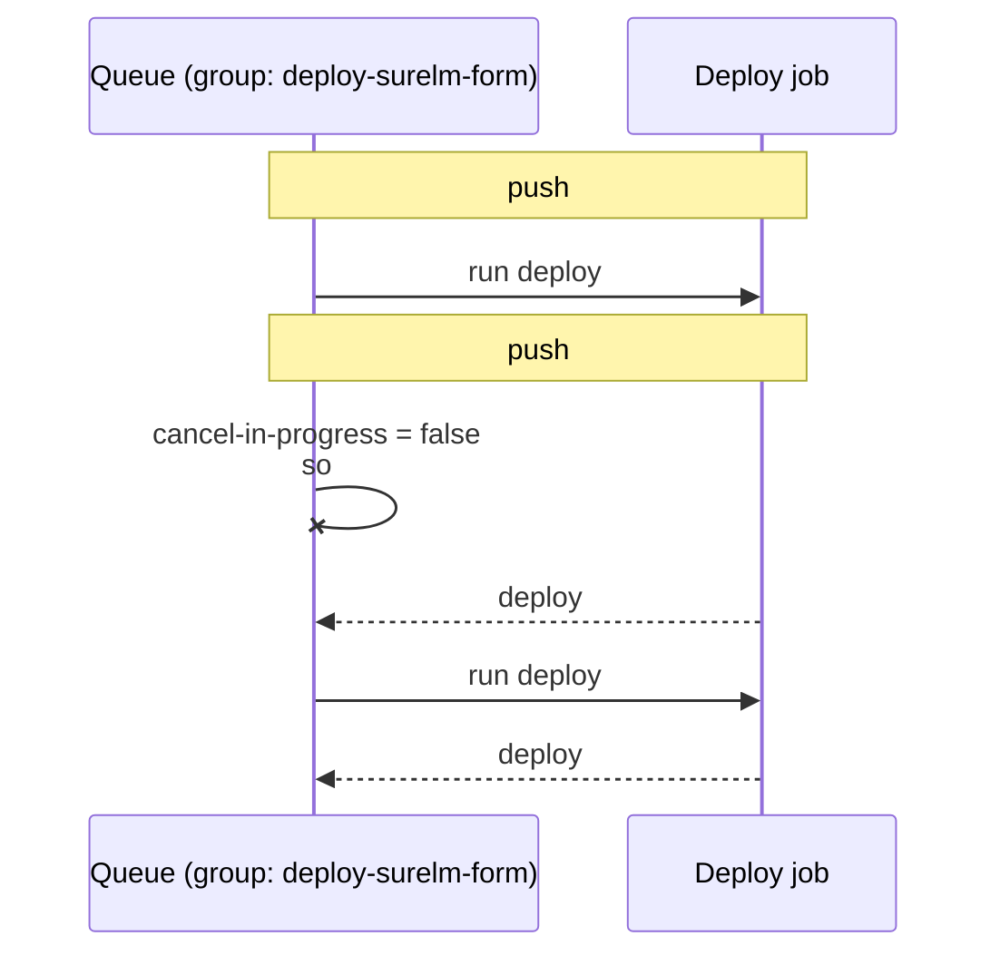

Contrast with `cancel-in-progress: true` (which we deliberately do **not**
use for deploys): that would kill deploy #1 halfway — a half-uploaded site.
Waiting a few extra minutes is much cheaper than an outage.

---

## 12. Secrets and Variables

Both live in the repo's **Settings → Secrets and variables**. The difference:

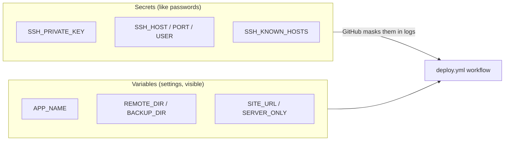

### Secrets (hidden — never written in files, never shown in logs)

| Secret | Meaning | Value status |
|--------|---------|--------------|
| `SSH_PRIVATE_KEY` | Private half of the SSH key allowed to log into the server. Matching **public** key is Authorize'd in cPanel. Generated locally with **no passphrase** (CI requirement). | set |
| `SSH_HOST` | Server address | `sh020.hostgator.in` |
| `SSH_PORT` | SSH port | `22` |
| `SSH_USER` | cPanel username | `esaad88a` |
| `SSH_KNOWN_HOSTS` | Pinned server fingerprint (from `ssh-keyscan`). Proves the runner talks to the **real** server, not an impostor. | set |

### Variables (settings — not secret)

| Variable | Meaning | Value for this repo |
|----------|---------|---------------------|
| `APP_NAME` | Deploy folder name **and** concurrency-group name. | `surelm-form` |
| `REMOTE_DIR` | Absolute path of the deploy target. | `/home1/esaad88a/public_html/staging-surelm/` (staging; flips to the live folder later) |
| `BACKUP_DIR` | Absolute path of backups — must be **outside** the live folder. | `/home1/esaad88a/backups/surelm-form` |
| `SITE_URL` | Public URL for the curl health check. Empty = skip. | staging URL, or empty for the first run |
| `SERVER_ONLY` | Extra rsync excludes, one per line. | empty for now |
| `NODE_VERSION` | Node version for the runner (unused here — no package.json). | — |

### GitHub Environments (`demo` → `production`)

```mermaid
flowchart LR
    Job["deploy job"] Env["environment: demo"]
    Env --> D1["Allowed to deploy:<br>the staging folder"]
    Note["Later: change to<br>environment: production"]
    Note -.-> Env2["environment: production<br>+ required reviewers"]
    Env2 --> Gate{"Human clicks<br>Approve?"}
    Gate -- Yes --> Real["Deploy to the live folder"]
    Gate -- No/timeout --> Cancel["Run stops safely"]
```

- The workflow is wired to the **`demo`** environment now — every deploy is
  explicitly a staging deploy.
- Switching to `production` later is a **one-line change** plus the
  variables flip. Add *required reviewers* to the `production` environment
  and GitHub pauses every production deploy until a human approves it.

---

## 13. Jenkins → GitHub Actions cheat sheet

| Jenkins | GitHub Actions | Why the change |
|---------|----------------|----------------|
| `when { branch 'main' }` | `on: push: branches: [main]` (+ separate `pull_request` trigger) | Events replace branch conditions |
| `lock(resource: ...)` | `concurrency:` group keyed on `APP_NAME`, `cancel-in-progress: false` | Built-in queue, no plugin needed |
| `timeout(time: 20, unit: 'MINUTES')` | `timeout-minutes: 20` per job | Same idea, simpler syntax |
| `sshagent(['cpanel-ssh-key'])` | key written from `secrets.SSH_PRIVATE_KEY` into the runner's `~/.ssh/` | Credentials come from GitHub Secrets |
| `sh '...'` | `run: |` (bash steps) | Direct shell on the runner |
| `post { failure { ... } }` | `if: failure()` step | Same behavior |
| Credentials store + plugins | Repo Settings → Secrets / Environments | No Jenkins server to secure |

---

## 14. How to verify a run

### On GitHub

1. Push a commit to `main` (or open a PR for a check-only run).
2. Repo page → **Actions** tab → click the workflow run.
3. Watch the jobs:
   - **build-test** — green means lint + detection passed;
   - **deploy** — green means backup + upload + health check all worked.
4. If a step fails, click it and read the log — the failing command is the
   last thing printed.

### On the server (after a successful deploy)

```mermaid
flowchart TD
    subgraph Server["What you should see"]
        Live["staging-surelm/<br>• index.html, quokka.php, css/, js/…<br>• version.txt (run + commit)<br>• NO .git/, NO .github/"]
        Bk["backups/surelm-form/<br>backup-&#60;run&#62;/ ← brand-new copy<br>exactly 5 folders max"]
    end
```

5. `version.txt` answers "which deploy is live?" — it contains the run
   number, the short commit SHA, and a UTC timestamp.
6. If the health check fails, the run turns **red** and the target folder is
   restored from the backup automatically — check the rollback step in the
   log.

---

*Document version 1 (surelm-form edition). Pipeline files:
`.github/workflows/deploy.yml` (main pipeline) and
`.github/workflows/test-connection.yml` (SSH sanity check that deploys
nothing). See `docs/Workflow-Explanation.md` for this repo's rollout plan.*
