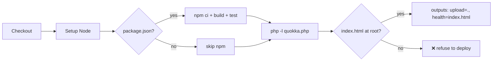
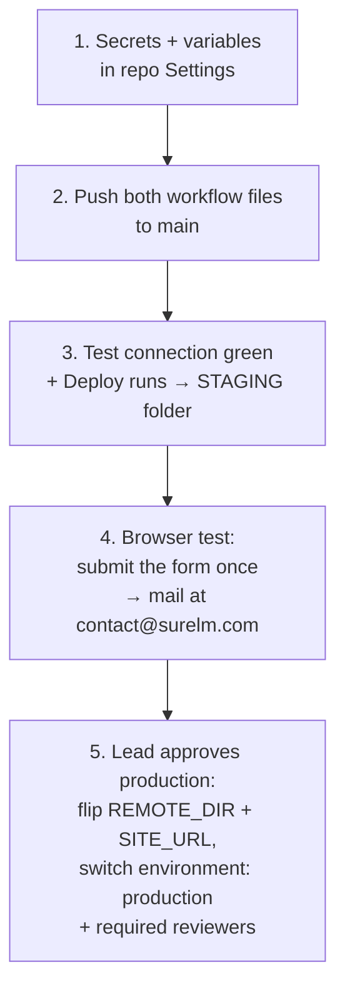

# Workflow Explanation — deploy.yml (surelm-form)

This document explains **the two workflow files in this repo**, what each job
and step does, the exact changes made from the proven demo pipeline, and how
the staged rollout to the HostGator cPanel server works.

Companion document: `docs/CICD-PIPELINE-EXPLAINED.md` — the full pipeline
theory with diagrams (backup rotation, rsync excludes, rollback, concurrency).

**Repo:** `sakshamist/surelm-form` — work happens **on `main`** (owner's
decision; the repo is small and the deploy target is a staging folder until
the production flip is explicitly approved).

---

## 1. The two files

| File | Purpose | Triggers |
|---|---|---|
| `.github/workflows/test-connection.yml` | Answers ONE question: *can a GitHub runner reach `sh020.hostgator.in` over SSH, log in with our key, and use rsync there?* **Deploys nothing.** | every push (any branch) **and** the manual *Run workflow* button |
| `.github/workflows/deploy.yml` | The real pipeline: lint → detect → backup → rsync → health check → rollback | push to `main`, PRs toward `main` (checks only), manual button |

Running the connection test on **every push** means any day SSH breaks (host
change, key revoked, IP restriction added), the very next push shows it
instantly — before a deploy even starts.

---

## 2. Changes from the proven demo pipeline (exactly 2 hunks)

The demo repos (`Techvenom18/demo-public`, `demo-private`) proved this
pipeline end-to-end. This repo's `deploy.yml` is a copy with **only two
additions** — nothing was deleted, renamed or reordered:

### Change ① — the `Install dependencies` step got a guard

The demo repos are Vite apps with a `package.json`; this repo is
static + PHP and has **none**. Plain `npm ci` would error out and fail the
whole run, so the existing step now checks first:

```yaml
- name: Install dependencies
  run: |
    if [ -f package.json ]; then
      npm ci
    else
      echo "No package.json (static/PHP repo) - skipping npm"
    fi
```

If a `package.json` ever appears in this repo, the npm path activates by
itself — no workflow edit needed.

### Change ② — a new `PHP lint` step

```yaml
- name: PHP lint
  run: php -l quokka.php
```

`quokka.php` is the form handler — if it ever ships with a syntax error,
**every application submission breaks silently**. `php -l` catches syntax
mistakes in seconds on every push, before anything touches the server.
(PHP 8.x is preinstalled on GitHub's Ubuntu runners — no extra setup.)

Everything else — all 5 protection layers, backup rotation, exclude list,
health checks, rollback, concurrency lock, timeouts, environments, alert and
key cleanup — is identical to the pipeline proven on the demo repos.

---

## 3. `test-connection.yml` — what each step checks

| Step | What it does | Failing means |
|---|---|---|
| **0: are the secrets configured?** | Verifies `SSH_HOST`, `SSH_PORT`, `SSH_USER` exist | secrets not (fully) added in Settings |
| **1: load key + fingerprint** | Writes the private key + `known_hosts` into the runner's `~/.ssh/` (the VM is destroyed after the run; the key is deleted at the end regardless) | a secret is empty |
| **2: TCP — SSH port** | Opens a raw TCP connection to `$SSH_HOST:$SSH_PORT` | wrong host/port, or the host blocks GitHub's runner IPs (IP-restriction question) |
| **3: TCP — cPanel port (2083)** | Informational only — Method B does not need the cPanel API | nothing — informational |
| **4: SSH login with the key** | Real login: `echo SSH_LOGIN_OK; whoami; uname -srm` | key not Authorize'd in cPanel, wrong user |
| **5: rsync on the server?** | `command -v rsync` remotely | rsync missing → Method B needs a fallback (lftp/SFTP) |
| **6: summary + key cleanup** | Prints the verdict table; always removes the key file | — |

---

## 4. `deploy.yml` — job by job

### Job 1: `build-test` (Jenkins stages: Checkout → Build → Test)



- Runs on **every** push and PR — zero risk (no server contact).
- The **detect step** decides the upload folder and refuses to continue if
  neither `dist/index.html`, `index.html` nor `index.php` exists. An empty
  upload + `rsync --delete` would wipe the target folder — the guard makes
  that impossible.
- For this repo the answer is always: **upload = repo root, health file =
  index.html**.

### Job 2: `deploy` (Jenkins stage: Deploy — only on push to `main`)

```mermaid
flowchart TD
    A[needs: build-test<br>tests failed = never starts] --> B[environment: demo<br>(staging)]
    B --> C[Guard: all settings present?<br>refuse if any variable missing]
    C --> D[Write SSH key + known_hosts<br>(never printed)]
    D --> E[Write exclude list]
    E --> F[Write version.txt]
    F --> G["Layer 2: backup → backup-N<br>keep newest 5"]
    G --> H["Layer 4: rsync -az --delete upload"]
    H --> I["Layer 4: index.html exists on server?"]
    I --> J{"SITE_URL set?"}
    J -- yes --> K[curl health check]
    J -- no --> L[✅ done]
    K --> L
    I -- fail --> M["Layer 4: rollback from backup-N"]
    H -- fail --> M
    M --> N[Run stays RED + alert step]
```

| Step | Plain meaning |
|---|---|
| `if: github.event_name == 'push' && github.ref == 'refs/heads/main'` | PRs and feature branches **never** deploy (Layer 5) |
| Settings guard | Fails fast with a message naming any missing variable — before any SSH command runs |
| SSH setup | Key comes from the secret store; host fingerprint is **pinned** (no "trust on first use" — impostor servers are refused) |
| Exclude list | `.git/`, `.github/`, `.env*`, `node_modules/`, … plus every line of `SERVER_ONLY` — never uploaded, never deleted (Layer 3) |
| `version.txt` | Contains `run=N commit=abc1234 time=…` — written **before** upload so you can always ask the server "which deploy is live?" |
| Backup step | `cp -a` of the target folder → `backup-<run>`; keeps only the newest 5 (Layer 2) |
| Upload step | `rsync -az --delete` with the exclude file (Layers 3+4) |
| Health checks | (1) `index.html` must exist on the server — always; (2) `curl SITE_URL` — only when the variable is set (Layer 4) |
| Rollback step | `if: failure()` — restores `backup-<run>` with the same excludes; the run **stays failed** so humans investigate (Layer 4) |
| Alert + key cleanup | Alert is a log placeholder until the team picks Slack/email; the key file is deleted even if earlier steps failed (Layer 5) |

### The concurrency lock (Layer 5)

```yaml
concurrency:
  group: deploy-${{ vars.APP_NAME || 'demo' }}
  cancel-in-progress: false
```

One deploy at a time per app — a second push **waits** in line instead of
killing a running deploy halfway (half-deployed sites are the classic
outage cause).

---

## 5. Secrets and variables for THIS repo

Set in **Settings → Secrets and variables → Actions** (never inside a file):

### Secrets — all 5 set

| Secret | Value |
|---|---|
| `SSH_HOST` | `sh020.hostgator.in` |
| `SSH_PORT` | `22` |
| `SSH_USER` | `esaad88a` |
| `SSH_PRIVATE_KEY` | the no-passphrase RSA key generated locally (public half Authorize'd in cPanel) |
| `SSH_KNOWN_HOSTS` | the `ssh-keyscan` fingerprint lines of `sh020.hostgator.in` |

### Variables

| Variable | First deploy (staging) | After the production flip |
|---|---|---|
| `APP_NAME` | `surelm-form` | unchanged |
| `REMOTE_DIR` | `/home1/esaad88a/public_html/staging-surelm/` | the live folder agreed with the lead |
| `BACKUP_DIR` | `/home1/esaad88a/backups/surelm-form` | unchanged |
| `SITE_URL` | empty (curl check skipped) | the live URL, e.g. `https://surelm.com/` |
| `SERVER_ONLY` | empty | whatever server-only files the live folder needs |

**Flipping to production is a variables edit, not a code change** — that is
the whole point of putting per-repo/per-environment settings in `${{ vars.* }}`.

---

## 6. Staged rollout



| Stage | Target on server | Who decides |
|---|---|---|
| Now | `/home1/esaad88a/public_html/staging-surelm/` (isolated — cannot affect any live site) | automatic on push to `main` |
| Later | the live folder (e.g. `public_html/surelm.com/`) | lead's explicit approval + Environment reviewers |

**Before the production flip, two questions for the lead:**

1. Confirm the exact live folder — and that a `rsync --delete` deploy there
   is safe (the live folder must contain only this app's files; anything
   extra — old backups, PDFs, other sites — must move out first; the backup
   step still preserves a copy of whatever was there).
2. Decide where failure alerts should go (Slack / email) and replace the
   placeholder `echo` in the alert step.

---

## 7. How to verify each stage

### After push (on GitHub)

- Actions tab → **Test connection**: steps 0–6 all PASS.
- Actions tab → **Deploy** → `build-test`: green; log shows
  *"No package.json … skipping npm"* and *"No syntax errors detected in
  quokka.php"*.
- Same run → `deploy` job: green through backup → upload → health check.

### After deploy (on the server)

```bash
ls -la /home1/esaad88a/public_html/staging-surelm/   # index.html, quokka.php, css/, js/, version.txt …
cat    /home1/esaad88a/public_html/staging-surelm/version.txt
ls -la /home1/esaad88a/backups/surelm-form/          # backup-<run>/ — newest first, max 5
```

### In the browser

- Open the staging URL → the form loads.
- Submit **one** test application → JSON `{success: true}` and a real mail
  at `contact@surelm.com` (warn the lead to expect exactly one test email).

---

## 8. Security rules for this pipeline (non-negotiable)

1. **Never** print, echo, commit, or chat-paste any key or token — only the
   5 secret **names** ever appear in files.
2. The private key lives in exactly two places: the developer's PC
   (`~/.ssh/`, never committed) and GitHub's secret store. No passphrase on
   the key — protection comes from access control, and a passphrase would
   make CI hang.
3. `permissions: contents: read` — the workflow can only read the repo.
4. PRs never receive deploy secrets (the deploy job does not run on PRs).
5. Backups live **outside** the deploy target — never web-accessible from
   inside the live folder.
6. No `rsync --delete` against an empty/wrong folder — enforced by the
   detect-step guard.
7. Production flips happen **only** with the lead's explicit approval, via
   variables — never by editing the workflow ad-hoc.

---

*Document version 1 (surelm-form). Written together with the first push of
`.github/workflows/deploy.yml` and `.github/workflows/test-connection.yml`.*
